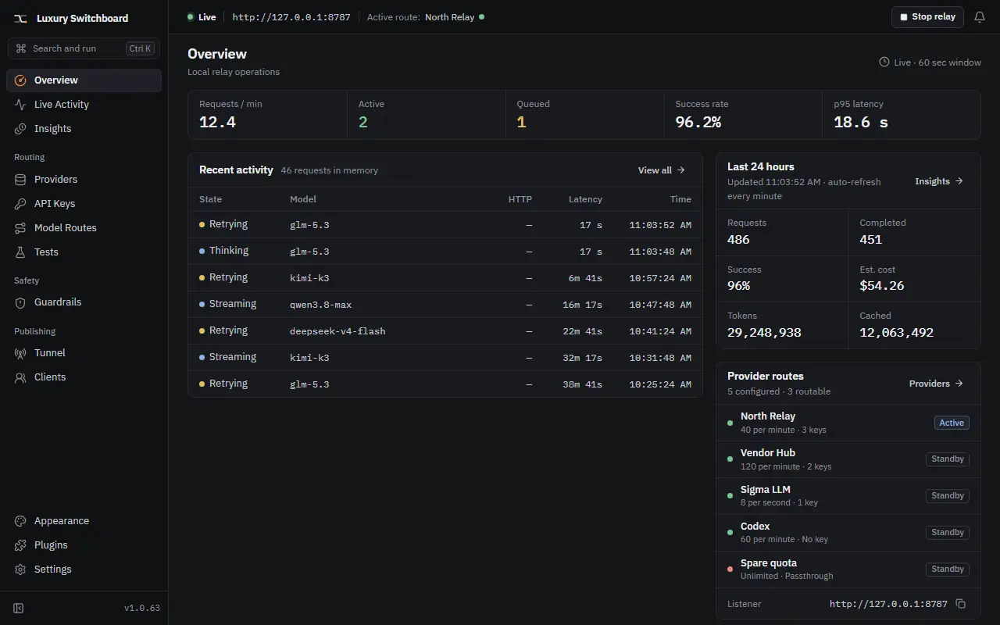
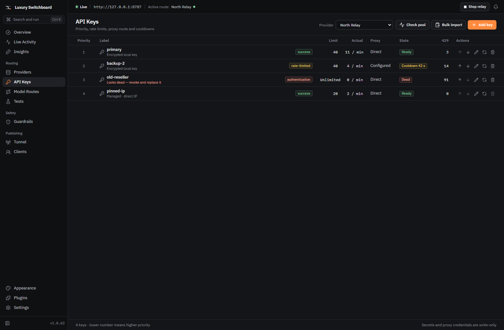
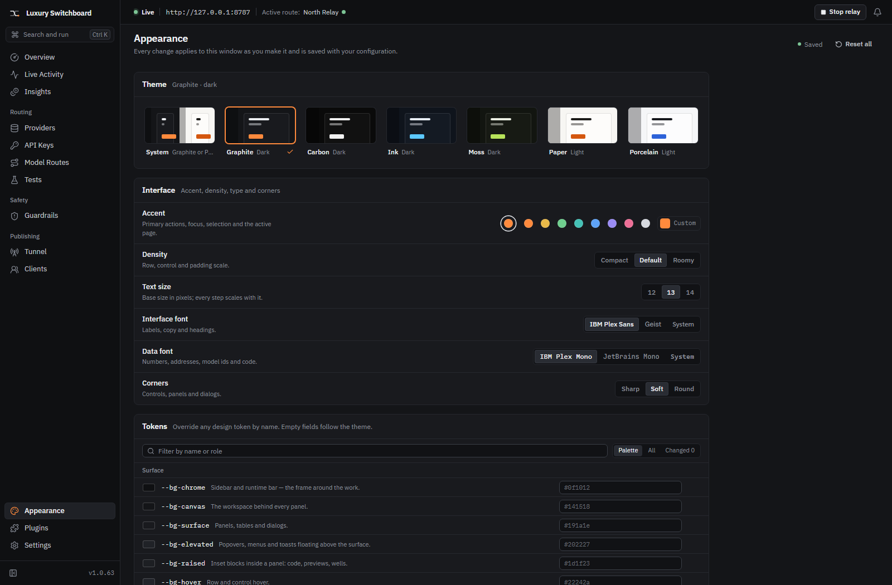
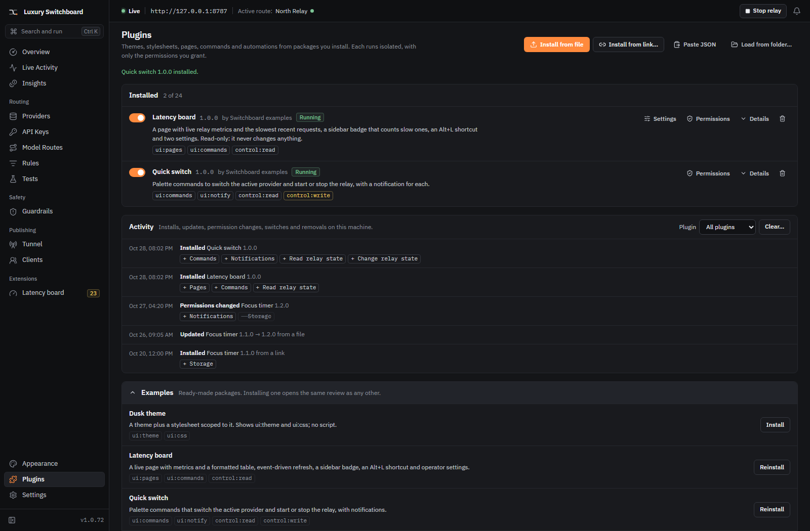

<div align="center">

# Luxury Switchboard

**One local endpoint for the AI providers you already use.**<br/>
An open-source desktop app that keeps provider routes, key pools, failover and request history in one place, so your clients only need one address.<br/>
No Luxury Switchboard account. No hosted control plane. Bring your own provider access.

[Download](https://github.com/GofMan5/luxury-switchboard/releases/latest) · [First request](#make-your-first-request) · [What leaves your machine](#what-stays-local-and-what-leaves) · [FAQ](#faq) · [Report a bug](https://github.com/GofMan5/luxury-switchboard/issues/new/choose)

[](LICENSE)
[](https://github.com/GofMan5/luxury-switchboard/releases/latest)
[](https://github.com/GofMan5/luxury-switchboard/releases/latest)
[](https://github.com/GofMan5/luxury-switchboard/stargazers)

<a href="docs/media/demo.mp4"></a>

<sub>A 51-second tour of the current interface · <a href="docs/media/demo.mp4">MP4 version</a> · the demo and screenshots use fictional data, never real credentials or traffic.</sub>

</div>

## The problem it solves

You use more than one AI provider. Each has its own keys, its own rate limits and its own model names. Every client you run (an editor, an agent, a script) needs its endpoint, key and model configured separately, so switching a provider, rotating a key or adding a fallback means editing all of them.

Luxury Switchboard sits between your clients and your providers:

- **Clients point at one address**: `http://127.0.0.1:8798/v1`, using model names you choose.
- **Routes live in the app**: map each alias to a provider and upstream model, pin a provider, or build an ordered failover chain.
- **Keys are pooled**: each provider gets a priority-ordered set of keys with rate limits, proxy routes and cooldowns. Keys are encrypted and write-only after saving.
- **You can see what happened**: every request shows its status, queueing, retries, tokens and timing. Cost estimates come from your own price catalog.

It manages access to models. It does not run models itself, and it does not include free API credits.

**It is probably not for you** if you use one client with one provider and are happy with that setup, or if you need a centrally operated multi-user server. This project is desktop-first.

## Install

Download the installer from the [latest release](https://github.com/GofMan5/luxury-switchboard/releases/latest): NSIS on Windows, AppImage or deb on Linux, dmg on macOS, each for x64 and arm64. Then:

1. **Providers**: add your OpenAI/Anthropic-compatible endpoint and configure its authentication. Remote endpoints require HTTPS; plain HTTP is allowed only for loopback providers.
2. **API Keys**: if the provider uses API-key authentication, add its keys one per line. They are encrypted per OS user and write-only after saving.
3. **Model Routes → Local relay → Add route**: choose the provider and an upstream model it actually supports. Set the public model name to `my-chat` and leave the route enabled.
4. Point your client at `http://127.0.0.1:8798/v1` and select `my-chat`. If you changed the listener port, use the address shown in the app instead.

Windows release installers are signed with Authenticode once the project's free [SignPath Foundation](https://signpath.org) signing is approved; see [Code signing policy](#code-signing-policy). Until then, and for every release before it, the installer is unsigned and Windows may show a SmartScreen warning. A signed installer shows *SignPath Foundation* under **Properties → Digital Signatures**, though SmartScreen can still warn while a new certificate builds reputation. Either way, before running the installer, verify it against the `SHA256SUMS.txt` **release asset**. On Windows, `Get-FileHash -Algorithm SHA256 .\YourDownloadedInstaller.exe` prints the digest (the filename here is only an example). A checksum detects a mismatch with the published release. It does not independently verify the publisher's identity.

Updates arrive in the app on every platform. The app downloads the installer for your OS and CPU and checks it against the release's own checksum. Windows then restarts into the setup, Linux replaces the running AppImage in place, and macOS replaces the app bundle from the dmg and relaunches. Where there is no self-update path, such as a deb install or a platform without its installer, the dialog says so and links to the release page.

### Make your first request

With the app running, a valid provider credential saved and the `my-chat` route configured above, send a small Chat Completions request. This contacts your configured provider and may incur its normal charges. Use a model that supports Chat Completions or the app's dialect translation; an alias does not add capabilities to a model.

**Windows PowerShell:**

```powershell
$body = @{
    model = 'my-chat'
    messages = @(@{ role = 'user'; content = 'Reply with one short greeting.' })
    max_tokens = 32
} | ConvertTo-Json -Depth 4

Invoke-RestMethod -Method Post `
    -Uri 'http://127.0.0.1:8798/v1/chat/completions' `
    -ContentType 'application/json' -Body $body -TimeoutSec 120
```

**macOS / Linux:**

```sh
curl --fail-with-body --max-time 120 \
  http://127.0.0.1:8798/v1/chat/completions \
  -H 'Content-Type: application/json' \
  -d '{"model":"my-chat","messages":[{"role":"user","content":"Reply with one short greeting."}],"max_tokens":32}'
```

Open **Live Activity** to check status, queueing and retries.

Some local clients insist on a non-empty API key. A dummy value such as `local-client` is enough, because the provider credential is configured in the app. This dummy key is **not** authentication for the public tunnel, which uses the access key shown on the Tunnel page. The relay listens on loopback only, but treat it as reachable by other processes on your machine.

If the request fails, check that:

- the relay is running;
- the route and the provider are enabled;
- the upstream model name is correct;
- a valid credential is available.

One successful HTTP request does not prove compatibility with every client's tools, images or streaming behavior.

## What you get

<table>
<tr>
<td width="50%" valign="top">

**Overview**: relay health at a glance, including requests per minute, active and queued work, success rate, p95 latency and the last 24 hours.


</td>
<td width="50%" valign="top">

**API Keys**: a priority-ordered pool per provider with rate limits, proxy routes and cooldowns. Saved keys are write-only: the app shows that a key exists, never its value. You can check the whole pool in one click, and keys that no longer work are marked.



</td>
</tr>
<tr>
<td width="50%" valign="top">

**Live Activity**: every request as it happens, with status, queue position, retries, tokens and speed. The inspector shows time to first token and generation speed. A waiting request shows why it is waiting.


</td>
<td width="50%" valign="top">

**Insights**: usage and cost per provider and model, priced from your own catalog in your own currency. The figures are estimates, not a provider invoice.


</td>
</tr>
<tr>
<td width="50%" valign="top">

**Tests**: short reachability checks or Full · 128k context probes per model, reporting first token, total time and decode rate. Probes never queue ahead of your traffic.


</td>
<td width="50%" valign="top">

**Model Routes**: discover provider catalogs, publish models under your own aliases, pin providers and build ordered failover chains. Local relay routes and public tunnel routes are configured separately.


</td>
</tr>
<tr>
<td width="50%" valign="top">

**Guardrails**: local inspection of provider answers after relay translation, before your client sees the content. Monitor mode is the default. Turn on blocking deliberately, globally or per provider. The UI shows counts, categories and safe excerpts, while rule patterns stay in the backend. The rules do not guarantee safe content.


</td>
<td width="50%" valign="top">

**Settings**: every value applies as soon as you save it, and each one has a plain-language explanation next to it. Settings cannot weaken the security invariants: listeners stay loopback-only, remote upstreams must use HTTPS, and the public tunnel fails closed.


</td>
</tr>
</table>

**Codex accounts are a preset provider.** Codex appears in the Add Provider list. You can sign in the official way through the browser, use a device code on a machine without a browser, or import the sign-in JSON that an existing Codex install already saved. An imported session is validated and refreshed before it is trusted. After that, the account joins the same pool, routes and guardrails as any other provider.

**Backups are explicit and labelled.** Settings can export providers, keys and routes to a JSON file in plain text, with no passphrase, so the file can be opened anywhere; both the panel and the file warn about this. The export is the only way credentials leave encrypted storage, and it happens only when you ask for it. Importing a backup uses the same validation as manual input, and entries that already exist are skipped.

## The tunnel in one click

The tunnel is optional and stays off until you start it. Press **Start** on the Tunnel page to get an HTTPS address and a stable access key. Anyone you share both with can use the models you published. Underneath, a pinned, checksum-verified [cloudflared](https://github.com/cloudflare/cloudflared) quick tunnel runs in front of a fail-closed gateway. You need no account, and no Luxury Switchboard server is involved; the traffic is carried by Cloudflare.

- **The address changes on every start; the key does not.** If you need a permanent URL, point any tunnel at the same local gateway.
- **Only what you publish, and only with the key.** The public side serves only your published aliases. Provider names, upstream URLs and raw model IDs are not included in anything that leaves the gateway. Public headers, JSON and streamed events are sanitized, and a refused provider gives the same answer as an offline one.
- **Clients get their own page**, with per-address history, bans and notes. This data is stored locally and never published.


## Make it yours

<table>
<tr>
<td width="50%" valign="top">

**Appearance**: four dark themes, two light themes, or follow the system setting. You can also change the accent color, density, text size, interface and data fonts, corner radius, any single design token, and add your own stylesheet. Each change applies immediately and is saved, encrypted, with the rest of your configuration.



</td>
<td width="50%" valign="top">

**Plugins**: one JSON file can add themes, stylesheets, sidebar pages with badges, palette commands with keyboard shortcuts, status items, operator settings and automations. You install a plugin from a file, a link or pasted JSON. Each plugin runs in its own sealed worker with only the permissions you select at install time. No plugin can manage plugins, backups or updates. The guide is [docs/PLUGINS.md](docs/PLUGINS.md). `pnpm plugin init|validate|run|pack` scaffolds, checks and packages a plugin, and coding agents can use the [switchboard-plugin skill](.agents/skills/switchboard-plugin/SKILL.md).



</td>
</tr>
</table>

Plugins are treated as untrusted until you grant otherwise. The highest-risk permissions start unticked:

- `control:sensitive` covers providers, keys, settings and the public tunnel.
- `net:fetch` allows HTTPS requests to the hosts the plugin lists.
- `relay:content` lets a plugin read and change prompts and answers on the local relay only, never on the tunnel.

The Plugins activity journal records changes to your plugins, and scripts cannot read it. The full model is in [docs/PLUGINS.md § Security model](docs/PLUGINS.md#security-model).

Ctrl+K opens a command palette for every page and action, and Alt+1…9 switches between pages. If a theme or plugin leaves the window unusable, Ctrl+Alt+Shift+S restarts the app in safe mode with plugins and custom styles turned off.

## What stays local and what leaves

**Stays on this machine.** All of it is encrypted with DPAPI on Windows or the desktop keyring elsewhere, with no plaintext fallback:

- Providers, API keys, proxy routes, model routes, settings, appearance and plugins. Configuration is stored in `%LOCALAPPDATA%\ProviderSwitchboard` on Windows, `~/.config/provider-switchboard` on Linux and `~/Library/Application Support/provider-switchboard` on macOS.
- Request history in local SQLite: status, timing, queue position, retries and token counts. It is kept for 30 days by default, configurable from 1 to 365.
- Guardrail inspection, with its rule data embedded in the app.
- Tunnel client history, bans and notes, and the plugin activity journal.

**Leaves this machine**, only to these destinations:

- Your requests and the matching provider credential go to the upstream you configured. Catalog discovery and model tests contact the same providers.
- Update checks and installer downloads go to GitHub. The app checks for updates every minute by default; **Settings** sets the interval or turns it off. Plugin update checks, once per launch, go to the hosts the plugins were installed from and can be turned off too.
- If you connect a Codex account, sign-in goes to OpenAI's sign-in and token endpoints.
- If you start the tunnel, the app downloads its connector when needed, and public tunnel traffic goes through Cloudflare.
- If you install a plugin from a link, the app fetches it from that address. Requests from plugins you granted `net:fetch` go to the HTTPS hosts you approved.

**Local does not mean offline.** Choose providers and enable these features according to your own trust requirements.

## FAQ

**Does it include models or free API access?** No. Bring your own provider account or compatible endpoint; the provider's charges and account terms still apply. Cost views are estimates based on the prices you configure and the usage data available, not a provider invoice.

**Does it run local models?** No. It is a relay, not an inference engine. A compatible server running on loopback can be an upstream, but you install and operate that server separately. Remote endpoints over plain HTTP are not allowed.

**Does it record my prompts?** Request history stores request metadata such as status, timing, retries and token counts. It does not store prompts or answers. Provider error messages are kept after redaction. Logs contain sanitized status, timing and token subsets, never prompts, response bodies or credentials. Guardrail findings show bounded excerpts of the answer that triggered them. A plugin you grant `relay:content` can read prompts and answers on the local relay; that permission starts unticked.

**Which clients work?** A client needs a configurable endpoint and a compatible request/response dialect. Chat Completions, Responses and Anthropic Messages have different semantics, so a matching URL shape alone does not guarantee compatibility. Test streaming, tools, images and cancellation with your actual client and model. The first-request example above is a starting point, not a certified list of clients.

**Does failover preserve model behavior?** No. One alias can map to different upstream model IDs, and their capabilities, quality, context limits and prices can differ. Choose the order of the chain deliberately.

**Do guardrails guarantee safe answers?** No. Inspection runs locally and defaults to monitor mode. The rules can miss harmful content or flag legitimate content, so review the findings and turn on block mode only when you mean to.

**Do I need the public tunnel?** No. Local relay routes and public tunnel routes are independent, so for a local-only workflow you can leave the tunnel stopped. Starting it exposes the aliases you explicitly published to anyone with the tunnel access key, which may generate usage on your provider accounts. The quick-tunnel address changes every time the tunnel restarts.

**How can I help?** [Report a reproducible bug](https://github.com/GofMan5/luxury-switchboard/issues/new/choose) and include the client, OS and app version you tried, or read [CONTRIBUTING.md](CONTRIBUTING.md). Never attach keys, sign-in JSON, exported backups or private prompts. Report security problems through a private advisory, as described in [SECURITY.md](SECURITY.md). If the project is useful to you, a GitHub star helps others find it.

## Development

Go 1.26.9+ · Rust 1.96+ · Node 24+ · pnpm 10+.

```powershell
pnpm install
pnpm dev      # the desktop app, debug relay on :18798
pnpm check    # the whole gate: go vet + tests + race, tsc, lint, vitest, builds
pnpm build    # the native installer for this host
```

Linux build hosts also need `libwebkit2gtk-4.1-dev libappindicator3-dev librsvg2-dev patchelf libfuse2`. `pnpm build` produces the installer for the host it runs on. Windows and Linux hosts build their own installers, macOS bundles build only on a Mac, and each CPU architecture needs its own host. CI builds all six installers on native runners.

The engineering contract lives in [AGENTS.md](AGENTS.md). It covers the hexagonal slices, the fail-closed boundary, and the privacy and honesty rules, and it is written for both people and coding agents.

## Code signing policy

Free code signing provided by [SignPath.io](https://about.signpath.io), certificate by [SignPath Foundation](https://signpath.org).

- Committers and reviewers: [GofMan5](https://github.com/GofMan5)
- Approvers: [GofMan5](https://github.com/GofMan5)

Only release tags built by this repository's GitHub Actions workflow are submitted for signing, and every signing request is approved manually. The signature covers the downloaded NSIS setup program, which is what Windows SmartScreen checks; the app files it installs are not individually signed. Setup steps for maintainers are in [docs/CODE-SIGNING.md](docs/CODE-SIGNING.md).

Privacy: apart from the update checks to GitHub and to plugin sources, which are on by default and can be turned off in **Settings**, this program does not transfer any information to other networked systems unless the user or the person operating it configures or requests it. The destinations are listed in [What stays local and what leaves](#what-stays-local-and-what-leaves).

## License

[MIT](LICENSE) · third-party attributions in [NOTICE](NOTICE) · guardrail data vendored from [holone](https://github.com/vanndh/holone) (MIT) · tunnel connector [cloudflared](https://github.com/cloudflare/cloudflared) (Apache-2.0, downloaded on first use at a pinned checksum).

<div align="center">

[](https://star-history.com/#GofMan5/luxury-switchboard&Date)

</div>