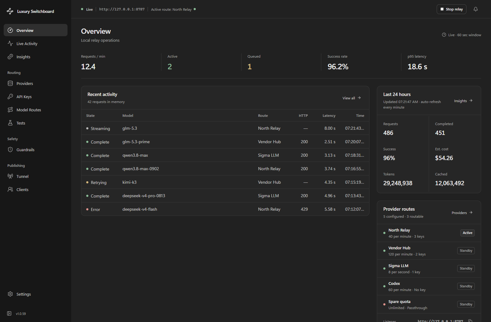
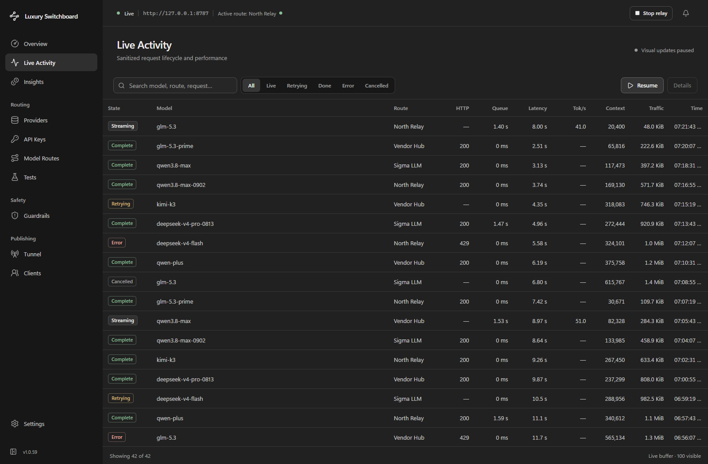
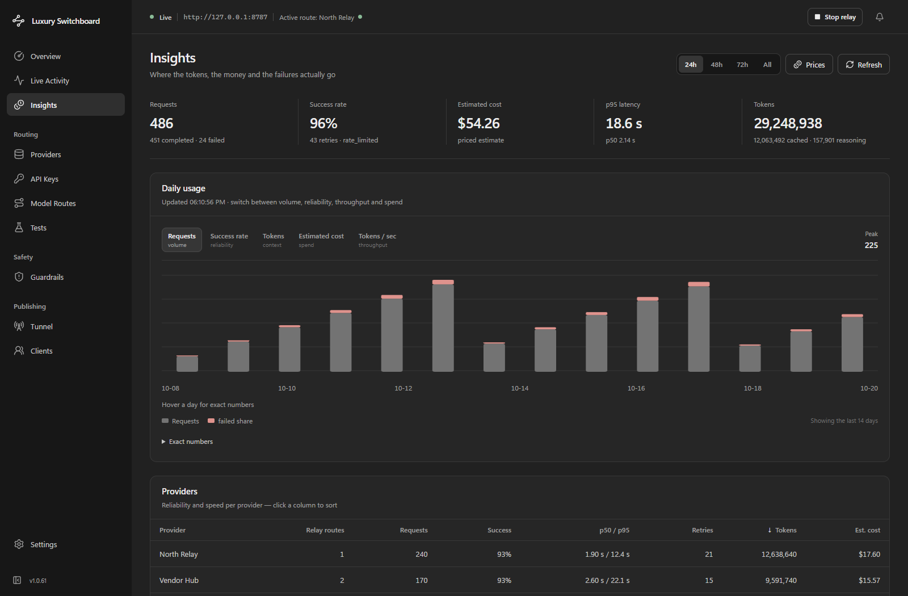
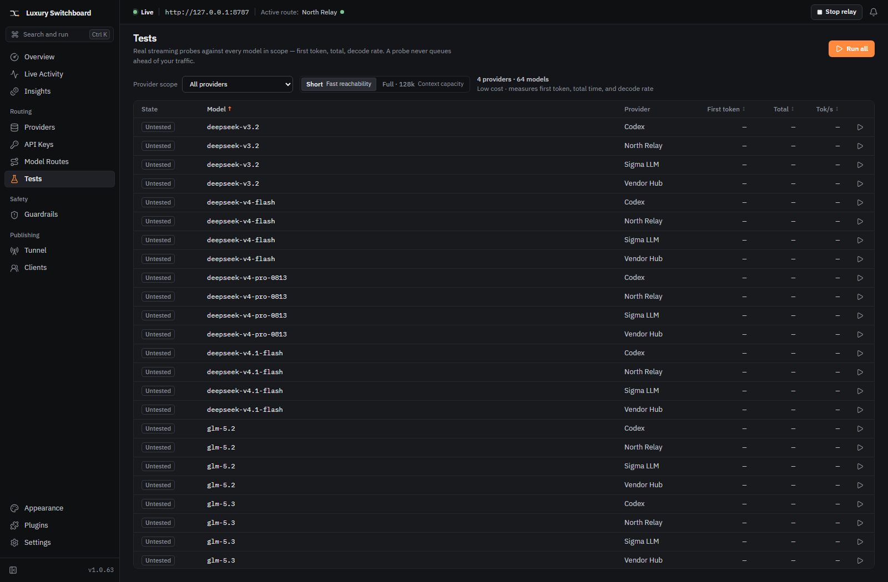
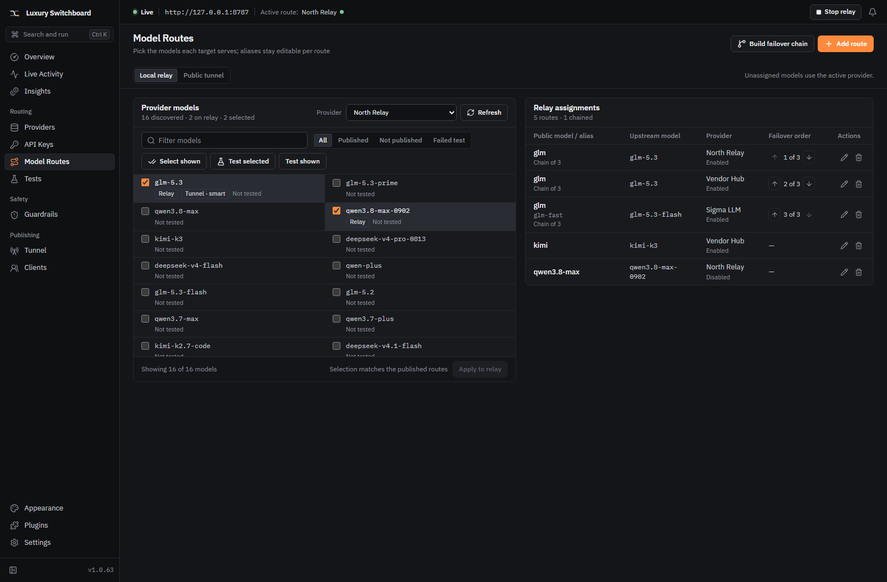
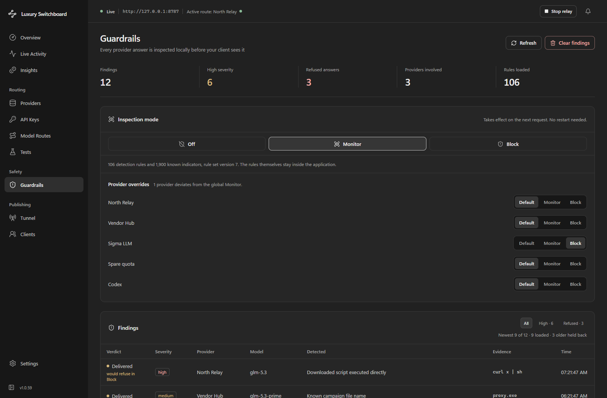
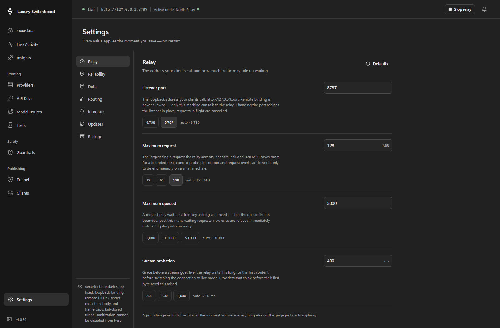
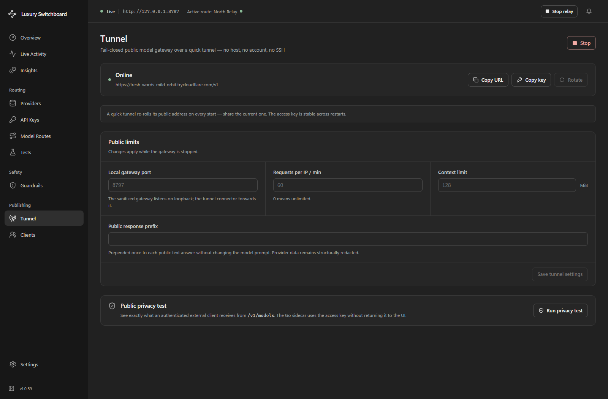

<div align="center">

# Luxury Switchboard

**One local endpoint for the AI providers you already use.**<br/>
An open-source desktop app for provider routes, key pools, live request activity and cost estimates.<br/>
No Luxury Switchboard account. No hosted control plane. Bring your own provider access.

[Download](https://github.com/GofMan5/luxury-switchboard/releases/latest) · [First request](#make-your-first-request) · [FAQ](#faq) · [Report a bug](https://github.com/GofMan5/luxury-switchboard/issues/new/choose)

[](LICENSE)
[](https://github.com/GofMan5/luxury-switchboard/releases/latest)
[](https://github.com/GofMan5/luxury-switchboard/releases/latest)
[](https://github.com/GofMan5/luxury-switchboard/stargazers)



<sub>Current interface · screenshots use fictional demo data, never real credentials or traffic.</sub>

</div>

## Who it is for

Use Luxury Switchboard when you have several AI clients or providers and want to change routes, keys and failover policy in one desktop app instead of editing every client. It manages access to models; it does not run models itself or include free API credits.

Already happy with one client and one provider? You may not need an extra relay. Need a centrally operated multi-user server? Evaluate that requirement separately: this project is desktop-first.

## Install

Grab the installer from the [latest release](https://github.com/GofMan5/luxury-switchboard/releases/latest): NSIS on Windows, AppImage/deb on Linux, dmg on macOS, in x64 and arm64 flavors. Then:

1. **Providers**: add your OpenAI/Anthropic-compatible endpoint and configure its authentication. Remote endpoints require HTTPS; HTTP is allowed for loopback providers.
2. **API Keys**: add your provider's keys, one per line, if it uses API-key authentication. They are encrypted per OS user and write-only after saving.
3. **Model Routes → Local relay → Add route**: choose the provider and an upstream model it actually supports. Set the public model name to `my-chat` and leave the route enabled.
4. Point your client at `http://127.0.0.1:8798/v1` and select `my-chat`. If you changed the listener port, use the address shown in the app instead.

Windows installers are not Authenticode-signed; Windows may show a SmartScreen warning. Verify the downloaded installer against the **release asset** `SHA256SUMS.txt` before running it. On Windows, `Get-FileHash -Algorithm SHA256 .\YourDownloadedInstaller.exe` prints the digest; the filename here is illustrative. Checksums detect a mismatch with the published release, not an independently verified publisher identity.

Updates arrive in-app on every platform: the app downloads the installer for your OS and CPU, checks it against the release's own checksum, then Windows restarts into the setup, Linux swaps the running AppImage in place, and macOS replaces the app bundle from the dmg and relaunches. Where no self-update path exists — a deb install, or a platform without its installer — the dialog says so and points at the release page.

### Make your first request

With the app running, a valid provider credential saved and the `my-chat` route configured above, send a small Chat Completions request. This contacts your configured provider and may incur its normal charges. Use a model that supports Chat Completions or the app's dialect translation; an alias does not add model capabilities.

**Windows PowerShell:**

```powershell
$body = @{
    model = 'my-chat'
    messages = @(@{ role = 'user'; content = 'Reply with one short greeting.' })
    max_tokens = 32
} | ConvertTo-Json -Depth 4

Invoke-RestMethod -Method Post `
    -Uri 'http://127.0.0.1:8798/v1/chat/completions' `
    -ContentType 'application/json' -Body $body -TimeoutSec 120
```

**macOS / Linux:**

```sh
curl --fail-with-body --max-time 120 \
  http://127.0.0.1:8798/v1/chat/completions \
  -H 'Content-Type: application/json' \
  -d '{"model":"my-chat","messages":[{"role":"user","content":"Reply with one short greeting."}],"max_tokens":32}'
```

Open **Live Activity** to check status, queueing and retries. For a local client that insists on a non-empty API key, a dummy value such as `local-client` is sufficient when the provider credential is configured in the app. This is **not** authentication for the public tunnel: that uses the access key shown on the Tunnel page. Treat the loopback relay as accessible to other processes on your machine.

If the request fails, check that the relay is running, the route and provider are enabled, the upstream model name is correct and a valid credential is available. A successful HTTP example does not establish compatibility with every client's tools, images or streaming behavior.

## What you get

<table>
<tr>
<td width="50%" valign="top">

**Live Activity**: every request as it happens. Status, queue, retries, tokens, speed. A waiting request says why.



</td>
<td width="50%" valign="top">

**Insights**: usage and cost per provider and model, priced from your own catalog in your own currency.



</td>
</tr>
<tr>
<td width="50%" valign="top">

**Tests**: Short reachability checks or Full · 128k context probes per model. First token, total, decode rate. Probes never queue ahead of your traffic.



</td>
<td width="50%" valign="top">

**Model Routes**: discover catalogs, publish models under your aliases, pin providers and build ordered failover chains.



</td>
</tr>
<tr>
<td width="50%" valign="top">

**Guardrails**: local inspection of provider answers after relay translation. Monitor by default; enable blocking deliberately. Rules are not a guarantee of safe content.



</td>
<td width="50%" valign="top">

**Settings**: every value applies the moment you save it, with a plain-words explanation next to each.



</td>
</tr>
</table>

**Codex accounts are a preset provider.** Add Provider lists Codex: sign in the official way through the browser, use a device code on a machine without one, or import the sign-in JSON an existing Codex install already saved. An imported session is validated and refreshed before it is trusted, and the account then joins the same pool, routes, and guardrails as any other provider.

## The tunnel in one click

Press **Start** on the Tunnel page and you get an HTTPS address plus a stable access key. Share both, and someone else is on your models. Underneath: a pinned, checksum-verified [cloudflared](https://github.com/cloudflare/cloudflared) quick tunnel in front of a fail-closed gateway. No account anywhere, nothing of ours in the middle.

- **The address re-rolls every start; the key doesn't.** Need a permanent URL? Point any tunnel at the same local gateway, it doesn't care.
- **Fail-closed means fail-closed.** Only your published aliases, only with the key. Provider names, upstream URLs and raw model IDs are structurally absent from what leaves. Not redacted: absent. A refused provider answers exactly like an offline one.
- **Clients get their own page**: per-address history, bans, notes. Stored locally, never published.



## Private by construction

Configuration is stored on your disk (`%LOCALAPPDATA%\ProviderSwitchboard` on Windows, `~/.config/provider-switchboard` on Linux, `~/Library/Application Support/provider-switchboard` on macOS), encrypted with DPAPI or the desktop keyring with no plaintext fallback. Request history uses local SQLite. The app has no hosted Luxury Switchboard control plane.

**Local does not mean offline.** Requests and provider credentials are sent to the upstreams you configure. Catalog discovery and model tests also contact those providers. Release checks/downloads contact GitHub; connecting a Codex account contacts OpenAI sign-in/token endpoints. Starting the optional tunnel downloads its connector when needed and carries public traffic through Cloudflare. Choose providers and enable these features according to your own trust requirements.

## FAQ

**Does it include models or free API access?** No. Bring a provider account or compatible endpoint. Provider charges and account terms still apply. Cost views are estimates based on your configured prices and available usage, not a provider invoice.

**Does it run local models?** It is a relay, not an inference engine. A compatible server on loopback can be an upstream; install and operate that server separately. Remote HTTP endpoints are not allowed.

**Which clients work?** Clients need a configurable endpoint and a compatible request/response dialect. Chat Completions, Responses and Anthropic Messages have different semantics. A shared URL shape alone is not a compatibility guarantee; test streaming, tools, images and cancellation for your actual client/model combination. The first-request example above is a starting point, not a certified client matrix.

**Does failover preserve model behavior?** No. A route can map one alias to different upstream model IDs; their capabilities, quality, context limits and prices can differ. Choose the chain deliberately.

**Do guardrails guarantee safe answers?** No. Inspection is local and defaults to monitor mode. Rules can miss harmful content or flag legitimate content; review findings and use block mode intentionally.

**Do I need the public tunnel?** No. Local relay and public tunnel routes are independent. Leave the tunnel stopped for a local-only workflow. Starting it exposes the explicitly published aliases to holders of the tunnel access key and may generate usage on your provider accounts. The quick-tunnel address changes on restart.

**How can I help?** [Report a reproducible bug](https://github.com/GofMan5/luxury-switchboard/issues/new/choose), tell us which client, OS and app version you tried, or read [CONTRIBUTING.md](CONTRIBUTING.md). Never attach keys, sign-in JSON, exported backups or private prompts. If the project is useful to you, a GitHub star helps others discover it.

## Development

Go 1.26.9+ · Rust 1.96+ · Node 24+ · pnpm 10+.

```powershell
pnpm install
pnpm dev      # the desktop app, debug relay on :18798
pnpm check    # the whole gate: go vet + tests + race, tsc, lint, vitest, builds
pnpm build    # the native installer for this host
```

Linux build hosts also need `libwebkit2gtk-4.1-dev libappindicator3-dev librsvg2-dev patchelf libfuse2`. `pnpm build` produces the installer for the host it runs on: Windows and Linux build their own, macOS bundles build only on a Mac, and each CPU architecture needs its own host. CI builds all six on their native runners.

The engineering contract (hexagonal slices, the fail-closed boundary, the honesty rules) lives in [AGENTS.md](AGENTS.md), written for people and coding agents alike.

## License

[MIT](LICENSE) · third-party attributions in [NOTICE](NOTICE) · guardrail data vendored from [holone](https://github.com/vanndh/holone) (MIT) · tunnel connector [cloudflared](https://github.com/cloudflare/cloudflared) (Apache-2.0, downloaded on first use at a pinned checksum).

<div align="center">

[](https://star-history.com/#GofMan5/luxury-switchboard&Date)

</div>
